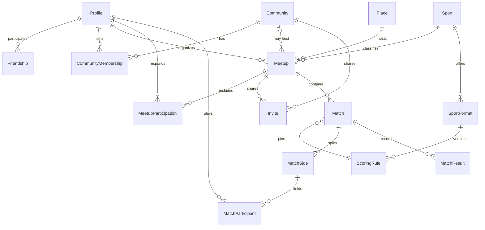

# Modelo de domínio

Modelo conceitual. Os nomes de código ficam em inglês; os nomes de produto, em português. Identidade, catálogo esportivo, amizades e encontros já têm migration em `supabase/migrations`. O restante deste documento ainda não virou tabela.

## Limites

- Amizade (`friendships`) não cria vaga em comunidade.
- Vaga em comunidade (`community_memberships`) não cria amizade.
- Encontro (`meetups`) existe com ou sem comunidade.
- Partida (`matches`) registra o jogo. O encontro registra o compromisso.
- Modalidade, formato e regra de pontuação são catálogo. O resultado é da partida.
- Estatística é leitura derivada. Não é entidade editável.

## Pessoas

`Profile` estende o usuário do Auth e usa o mesmo UUID.

Implementado agora:

- `username`, único sem distinguir maiúsculas, guardado em minúsculas no formato `^[a-z][a-z0-9_]{2,29}$`
- `display_name`, com acentos
- `visibility`: `private` ou `public`, padrão `private`
- `time_zone` IANA em `profile_preferences`, visível só para o próprio usuário

Ainda não entram avatar, bio, nem visibilidade `friends`. Histórico e estatísticas também não têm coluna nesta fase. A leitura de um perfil público exige autenticação. Preferências não saem nessa leitura.

Padrão anterior, perfil público e histórico visível para amigos, foi adiado. A revisão está na [ADR-017](./DECISIONS.md). Amizade confirmada não abre o perfil privado. A exceção está na [ADR-020](./DECISIONS.md).

## Amizades

Implementado em `friendships`. Uma relação é uma linha, com `requester_id` e `addressee_id`. O par é único pela ordem menor/maior dos dois ids, então A pedir B e B pedir A não criam duas amizades. Ninguém solicita a si mesmo.

Estados: `pending`, `accepted`, `rejected`, `cancelled` e `removed`. `removed` é o fim de uma amizade que já tinha sido aceita. Recusa e cancelamento nunca passaram por aceite.

| De                                      | Para        | Quem                   |
| --------------------------------------- | ----------- | ---------------------- |
| inexistente ou encerrada fora da espera | `pending`   | quem pede, pela função |
| `pending`                               | `accepted`  | só o destinatário      |
| `pending`                               | `rejected`  | só o destinatário      |
| `pending`                               | `cancelled` | só o solicitante       |
| `accepted`                              | `removed`   | qualquer um dos dois   |

A escrita direta na tabela é recusada. As funções `request_friendship`, `respond_to_friendship` e `list_my_friendships` são o caminho. Elas travam o par na transação. Depois de recusa, cancelamento ou remoção, o mesmo par só volta a `pending` quando `closed_at` completa 24 horas. Há no máximo 30 solicitações pendentes de saída por pessoa.

A lista devolve o username da outra pessoa, mesmo que o perfil seja privado. Não devolve nome de exibição, e-mail nem fuso. Busca é pelo username exato; não há listagem geral nem busca por e-mail.

Bloqueio ainda não existe. Quando existir, será uma tabela própria, consultada por essas funções antes de criar ou listar a relação. Não será mais um estado de `friendships`, e não apaga vaga de comunidade.

## Catálogo esportivo

Implementado em `sports`, `sport_formats` e `scoring_rule_versions`. O cliente lê as linhas ativas. Inserir, alterar e apagar fica nas migrations: não há política de escrita para `anon` nem `authenticated`.

`sports` é a modalidade. O slug é único, em minúsculas e com hífen (`volleyball`, `beach-volleyball`). `display_order` define a ordem da tela, para o alfabeto não virar a ordem do produto. Nome, descrição opcional e `active` completam o registro.

`sport_formats` é uma variante daquela modalidade. A quantidade de jogadores não fica na modalidade: cada formato tem `side_count` e o intervalo `players_per_side_min` / `players_per_side_max`. O intervalo existe para um formato recreativo poder aceitar de 4 a 6 atletas sem abrir outra tabela. Os formatos iniciais usam mínimo igual ao máximo. O slug é único dentro da modalidade.

`scoring_rule_versions` é a versão imutável da pontuação de um formato. A unicidade é `(format_id, version)`. Só uma versão ativa por formato. Uma partida futura guarda `scoring_rule_versions.id`, não o slug nem o JSON vigente. Mudar o regulamento é inserir outra versão e desativar a anterior. Um gatilho recusa apagar a linha e recusa mudar formato, versão, tipo, configuração, origem ou data de criação. O campo `active` pode mudar.

O tipo não é um inteiro genérico chamado "pontos". A configuração é JSONB com as chaves daquele tipo, conferidas no banco e de novo no Zod. Campo fora do tipo, ou combinação inválida, não entra. `origin` distingue `official_summary` (só o formato do placar, não o livro de regras) de `app_proposal` (proposta do PaDre para jogo recreativo).

| Tipo         | Configuração                                                                    | Desfecho previsto, ainda sem motor |
| ------------ | ------------------------------------------------------------------------------- | ---------------------------------- |
| `set_based`  | sets para vencer, pontos do set, diferença mínima, set decisivo e teto opcional | lado que vence os sets exigidos    |
| `goal_based` | empate permitido e, se não houver empate, prorrogação ou pênaltis               | maior placar, ou empate            |
| `game_based` | games do set, sets para vencer, diferença, tiebreak e super tiebreak opcional   | lado que vence a estrutura         |

| Tipo         | Uso inicial                                      | Payload conceptual                         | Desfecho                                |
| ------------ | ------------------------------------------------ | ------------------------------------------ | --------------------------------------- |
| `set_based`  | Vôlei, vôlei de areia, futevôlei, parte do beach | Sets com placar de cada lado e meta do set | Lado que vence o número exigido de sets |
| `goal_based` | Futsal                                           | Gols por lado                              | Maior placar, ou empate                 |
| `game_based` | Beach tennis em games                            | Games ou sets de games, incluindo tiebreak | Lado que vence a estrutura configurada  |

Exemplos que o catálogo inicial precisa conseguir representar, como dados e não como `if` espalhado:

- Vôlei: melhor de 5 sets, sets a 25 com diferença de 2, quinto set a 15.
- Vôlei de areia: melhor de 3, sets a 21, terceiro a 15.
- Futevôlei: regra própria, mesmo quando o placar se parece com o de areia. Não é um apelido da outra modalidade.
- Futsal: dois tempos, gols, empate possível.
- Beach tennis: mais de um formato convive (set longo, super tiebreak, simples ou duplas).

Catálogo inicial, versão 1:

- Vôlei 6x6: resumo do placar de quadra, 3 sets a 25, decisivo a 15, diferença 2.
- Vôlei 4x4: proposta do PaDre com o mesmo placar, quatro jogadores por lado.
- Vôlei de areia 2x2: resumo do placar de areia, 2 sets a 21, decisivo a 15, diferença 2.
- Vôlei de areia 4x4: proposta do PaDre com esse placar, quatro jogadores por lado.
- Futsal 5x5: gols, empate possível, sem desempate nesta versão.
- Beach tennis individual: proposta de um set a 6 games, diferença 2, tiebreak a 7.
- Beach tennis em duplas: proposta de 2 sets, com super tiebreak decisivo a 10.
- Futevôlei 2x2: proposta própria, 2 sets a 18, decisivo a 15. Não reutiliza a linha da areia.

Para incluir outra modalidade, outra variante ou outra versão, a mudança é uma migration nova. Não se edita a migration já aplicada.

1. Nova modalidade: `insert` em `sports` com UUID fixo, slug único e `display_order` livre.
2. Novo formato: `insert` em `sport_formats` apontando para a modalidade, com mínimo e máximo de jogadores daquele formato.
3. Nova versão de regra: desligar `active` da versão atual daquele formato e inserir a próxima `version` com o mesmo `format_id` e um UUID novo. A linha antiga permanece. O gatilho impede reescrever `config`.

`resolveOutcome(rule, payload)` continua sendo a interpretação do placar, e ainda não existe. Esta fase valida a configuração. A fase de partidas calcula o desfecho e o grava. Uma correção gera nova revisão do resultado e recalcula.

## Encontros e locais

Implementado em `meetups`, `meetup_participants` e `meetup_invitations`. O domínio da arquitetura continua `meetups`; a rota de produto é `/encontros`. A decisão está na [ADR-022](./DECISIONS.md).

`Meetup` guarda o organizador, o formato do catálogo e a `scoring_rule_versions.id` escolhida na criação. A modalidade sai do formato. O instante fica em `starts_at` e `ends_at` (`timestamptz`). `time_zone` é um nome IANA e só serve para mostrar o horário. O local desta fase é texto: `location_name` e `location_address`. Não há ponto geográfico ainda.

Estados do encontro: `scheduled` e `cancelled`. `completed` entra numa migration futura, quando houver fechamento de presença, e não será preenchido por um relógio automático.

A capacidade inclui quem organiza, vai de 2 a 64 e conta só participantes `confirmed`. Quem está `left` ou `removed` não ocupa vaga. Quem saiu não volta nesta versão. A reentrada futura reabre a mesma linha, de novo com a trava da linha do encontro.

`MeetupInvitation` é um convite para uma conta já cadastrada e amiga. Estados: `pending`, `accepted`, `declined`, `cancelled`. Pendente não ocupa vaga. Aceitar cria a participação na mesma transação. Há no máximo uma linha por pessoa e encontro.

`Place` com `geography(Point, 4326)`, `community_id` e visibilidade pública continuam conceito.

## Convites

O convite para uma conta amiga continua em `meetup_invitations`. O link compartilhável é `meetup_invite_links`: um encontro, quem gerou, `token_hash`, `expires_at`, `revoked_at` e `created_at`. Não há coluna de token cru, nem `max_uses`. A capacidade do encontro é o limite de uso. A linha revogada permanece.

Um convite interno `pending`, `declined` ou `cancelled` passa a `accepted` quando a mesma pessoa entra pelo link, na mesma transação da vaga. Quem já está `confirmed` recebe a mesma resposta de novo, sem segunda vaga. Quem está `left` ou `removed` não volta.

Convite de comunidade, e-mail pré-vinculado e limite de usos separado da capacidade continuam fora. O resgate continua sendo função, nunca um `select` pelo token.

## Comunidades

`Community`: nome, descrição, visibilidade.

`CommunityMembership`:

- papel: `member` ou `admin`
- estado: `invited`, `active`, `left`, `removed`

Toda comunidade permanece com ao menos um administrador. Encontro coletivo é um encontro com `community_id` preenchido, não uma terceira entidade de evento.

## Partidas

`Match` acontece dentro de um encontro.

- modalidade, formato e `scoring_rule_id` da versão usada
- estado: `draft`, `confirmed`, `voided`
- `confirmed_at` e autoria da confirmação
- anulação com motivo, que tira a partida das estatísticas

`MatchSide` é um lado (não uma equipe permanente do produto). `MatchParticipant` liga uma pessoa a um lado. Equipes duradouras, se existirem um dia, não substituem o lado desta partida: o lado é o que o resultado precisa.

`MatchResult` é revisado. Uma revisão vigente por partida. Correção insere outra revisão e marca a anterior como substituída. Cliente não atualiza projeção.

Somente `confirmed` com revisão vigente entra na estatística.

## Estatísticas

Não há tabela de "vitórias do atleta" editável. Há projeção reconstruível, com uma escrita por partida, contendo pelo menos:

- atleta, modalidade, partida, desfecho
- par de confronto na mesma partida
- par de companheiros no mesmo lado
- atleta, local e partida, quando o encontro tem local

As consultas do produto agregam essas linhas. Reprocessar apaga e recria o recorte a partir dos resultados confirmados, com o mesmo código da escrita incremental.

## Mensagens, enquetes e rankings

Conceitos reservados, sem tabela nesta etapa:

- `Conversation` presa a um encontro ou a uma comunidade
- `Message` nessa conversa
- `Poll`, opções e votos no mesmo escopo
- ranking como ordenação de uma projeção num escopo (modalidade ou comunidade), com data de geração, nunca como pontuação digitada

## Relações

