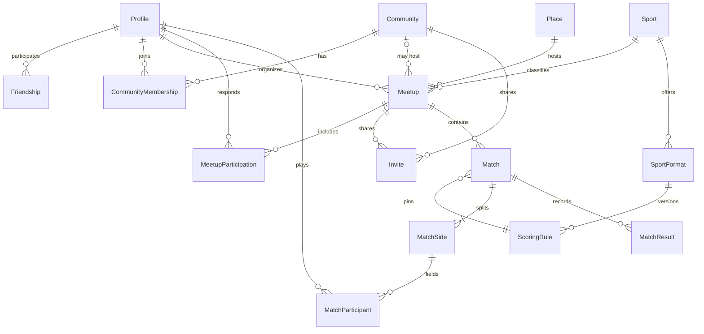

# Modelo de domínio

Modelo conceitual. Os nomes de código ficam em inglês; os nomes de produto, em português. A migration de identidade está em `supabase/migrations`. O restante deste documento ainda não virou tabela.

## Limites

- Amizade (`friendships`) não cria vaga em comunidade.
- Vaga em comunidade (`community_memberships`) não cria amizade.
- Encontro (`meetups`) existe com ou sem comunidade.
- Partida (`matches`) registra o jogo. O encontro registra o compromisso.
- Modalidade, formato e regra de pontuação são catálogo. O resultado é da partida.
- Estatística é leitura derivada. Não é entidade editável.

## Pessoas

`Profile` estende o usuário do Auth e usa o mesmo UUID.

Implementado agora:

- `username`, único sem distinguir maiúsculas, guardado em minúsculas no formato `^[a-z][a-z0-9_]{2,29}$`
- `display_name`, com acentos
- `visibility`: `private` ou `public`, padrão `private`
- `time_zone` IANA em `profile_preferences`, visível só para o próprio usuário

Ainda não entram avatar, bio, nem visibilidade `friends`. Histórico e estatísticas também não têm coluna nesta fase. A leitura de um perfil público exige autenticação. Preferências não saem nessa leitura.

Padrão anterior, perfil público e histórico visível para amigos, foi adiado. A revisão está na [ADR-017](./DECISIONS.md).

## Catálogo esportivo

`Sport` é a modalidade. Slug estável, nome, e a indicação de que novos registros podem entrar sem mudança de código.

`SportFormat` descreve como se joga aquela modalidade numa variante:

- quantidade de lados (em geral dois)
- mínimo e máximo de atletas por lado, para caber o jogo recreativo e o regulamento cheio
- regra de pontuação padrão

`ScoringRule` é uma versão imutável dessa regra. A partida guarda o identificador da versão. Mudar o regulamento cria outra versão; partidas antigas continuam na anterior.

O tipo da regra não é um inteiro genérico chamado "pontos". Cada tipo tem payload e interpretação próprios. O conjunto de tipos é aberto.

| Tipo         | Uso inicial                                      | Payload conceptual                         | Desfecho                                |
| ------------ | ------------------------------------------------ | ------------------------------------------ | --------------------------------------- |
| `set_based`  | Vôlei, vôlei de areia, futevôlei, parte do beach | Sets com placar de cada lado e meta do set | Lado que vence o número exigido de sets |
| `goal_based` | Futsal                                           | Gols por lado                              | Maior placar, ou empate                 |
| `game_based` | Beach tennis em games                            | Games ou sets de games, incluindo tiebreak | Lado que vence a estrutura configurada  |

Exemplos que o catálogo inicial precisa conseguir representar, como dados e não como `if` espalhado:

- Vôlei: melhor de 5 sets, sets a 25 com diferença de 2, quinto set a 15.
- Vôlei de areia: melhor de 3, sets a 21, terceiro a 15.
- Futevôlei: regra própria, mesmo quando o placar se parece com o de areia. Não é um apelido da outra modalidade.
- Futsal: dois tempos, gols, empate possível.
- Beach tennis: mais de um formato convive (set longo, super tiebreak, simples ou duplas).

`resolveOutcome(rule, payload)` é a única interpretação. Ela devolve um lado ou `draw`. A confirmação persiste esse desfecho calculado. Uma correção gera nova revisão e recalcula.

## Encontros e locais

`Place`: nome, endereço formatado e ponto `geography(Point, 4326)`. A coordenada serve ao mapa e, no futuro, ao transporte. Estatística por local usa o identificador do lugar, não o texto livre.

`Meetup`:

- organizador
- modalidade
- `community_id` opcional
- `place_id`
- `starts_at` em `timestamptz` e `time_zone` IANA
- visibilidade: `public`, `friends` ou `invite_only`
- ciclo: `draft`, `published`, `cancelled`, `completed`

`MeetupParticipation` é a vaga de uma pessoa naquele encontro.

- papel: `organizer` ou `player`
- estado: `invited`, `pending`, `confirmed`, `declined`, `waitlisted`, `cancelled`, `attended`, `absent`

`pending` é pedido para entrar. `invited` é convite ainda sem resposta. `cancelled` é desistência depois de confirmar. `attended` e `absent` são fechamento feito pela organização, não um placar.

## Convites

`Invite` aponta para um encontro ou para uma comunidade, nunca para os dois ao mesmo tempo.

- alvo `user` (pessoa já cadastrada) ou `link` (pode ser aberto por quem ainda não tem conta)
- `token_hash`, `expires_at`, `max_uses`, `use_count`
- estado: `active`, `revoked`, `exhausted`, `expired`
- e-mail opcional, só para pré-vincular um link, sem servir de segredo

O token cru aparece uma vez, no link. O resgate cria ou atualiza a participação e só então incrementa o uso.

## Comunidades

`Community`: nome, descrição, visibilidade.

`CommunityMembership`:

- papel: `member` ou `admin`
- estado: `invited`, `active`, `left`, `removed`

Toda comunidade permanece com ao menos um administrador. Encontro coletivo é um encontro com `community_id` preenchido, não uma terceira entidade de evento.

## Partidas

`Match` acontece dentro de um encontro.

- modalidade, formato e `scoring_rule_id` da versão usada
- estado: `draft`, `confirmed`, `voided`
- `confirmed_at` e autoria da confirmação
- anulação com motivo, que tira a partida das estatísticas

`MatchSide` é um lado (não uma equipe permanente do produto). `MatchParticipant` liga uma pessoa a um lado. Equipes duradouras, se existirem um dia, não substituem o lado desta partida: o lado é o que o resultado precisa.

`MatchResult` é revisado. Uma revisão vigente por partida. Correção insere outra revisão e marca a anterior como substituída. Cliente não atualiza projeção.

Somente `confirmed` com revisão vigente entra na estatística.

## Estatísticas

Não há tabela de "vitórias do atleta" editável. Há projeção reconstruível, com uma escrita por partida, contendo pelo menos:

- atleta, modalidade, partida, desfecho
- par de confronto na mesma partida
- par de companheiros no mesmo lado
- atleta, local e partida, quando o encontro tem local

As consultas do produto agregam essas linhas. Reprocessar apaga e recria o recorte a partir dos resultados confirmados, com o mesmo código da escrita incremental.

## Mensagens, enquetes e rankings

Conceitos reservados, sem tabela nesta etapa:

- `Conversation` presa a um encontro ou a uma comunidade
- `Message` nessa conversa
- `Poll`, opções e votos no mesmo escopo
- ranking como ordenação de uma projeção num escopo (modalidade ou comunidade), com data de geração, nunca como pontuação digitada

## Relações

