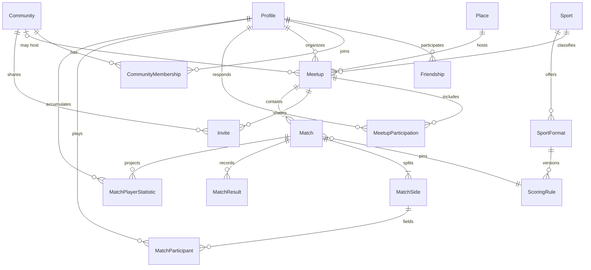

# Modelo de domínio

Modelo conceitual. Os nomes de código ficam em inglês; os nomes de produto, em português. Identidade, catálogo esportivo, amizades, encontros, partidas, estatísticas e comunidades já têm migration em `supabase/migrations`. Locais, mensagens e rankings ainda não viraram tabela.

## Limites

- Amizade (`friendships`) não cria vaga em comunidade.
- Vaga em comunidade (`community_members`) não cria amizade.
- Encontro (`meetups`) existe com ou sem comunidade.
- Partida (`matches`) registra o jogo. O encontro registra o compromisso.
- Modalidade, formato e regra de pontuação são catálogo. O resultado é da partida.
- Estatística é leitura derivada. Não é entidade editável.

## Pessoas

`Profile` estende o usuário do Auth e usa o mesmo UUID.

Implementado agora:

- `username`, único sem distinguir maiúsculas, guardado em minúsculas no formato `^[a-z][a-z0-9_]{2,29}$`
- `display_name`, com acentos
- `visibility`: `private` ou `public`, padrão `private`
- `time_zone` IANA em `profile_preferences`, visível só para o próprio usuário

Ainda não entram avatar, bio, nem visibilidade `friends`. Histórico e estatísticas também não têm coluna nesta fase. A leitura de um perfil público exige autenticação. Preferências não saem nessa leitura.

Padrão anterior, perfil público e histórico visível para amigos, foi adiado. A revisão está na [ADR-017](./DECISIONS.md). Amizade confirmada não abre o perfil privado. A exceção está na [ADR-020](./DECISIONS.md).

## Amizades

Implementado em `friendships`. Uma relação é uma linha, com `requester_id` e `addressee_id`. O par é único pela ordem menor/maior dos dois ids, então A pedir B e B pedir A não criam duas amizades. Ninguém solicita a si mesmo.

Estados: `pending`, `accepted`, `rejected`, `cancelled` e `removed`. `removed` é o fim de uma amizade que já tinha sido aceita. Recusa e cancelamento nunca passaram por aceite.

| De                                      | Para        | Quem                   |
| --------------------------------------- | ----------- | ---------------------- |
| inexistente ou encerrada fora da espera | `pending`   | quem pede, pela função |
| `pending`                               | `accepted`  | só o destinatário      |
| `pending`                               | `rejected`  | só o destinatário      |
| `pending`                               | `cancelled` | só o solicitante       |
| `accepted`                              | `removed`   | qualquer um dos dois   |

A escrita direta na tabela é recusada. As funções `request_friendship`, `respond_to_friendship` e `list_my_friendships` são o caminho. Elas travam o par na transação. Depois de recusa, cancelamento ou remoção, o mesmo par só volta a `pending` quando `closed_at` completa 24 horas. Há no máximo 30 solicitações pendentes de saída por pessoa.

A lista devolve o username da outra pessoa, mesmo que o perfil seja privado. Não devolve nome de exibição, e-mail nem fuso. Busca é pelo username exato; não há listagem geral nem busca por e-mail.

Bloqueio ainda não existe. Quando existir, será uma tabela própria, consultada por essas funções antes de criar ou listar a relação. Não será mais um estado de `friendships`, e não apaga vaga de comunidade.

## Catálogo esportivo

Implementado em `sports`, `sport_formats` e `scoring_rule_versions`. O cliente lê as linhas ativas. Inserir, alterar e apagar fica nas migrations: não há política de escrita para `anon` nem `authenticated`.

`sports` é a modalidade. O slug é único, em minúsculas e com hífen (`volleyball`, `beach-volleyball`). `display_order` define a ordem da tela, para o alfabeto não virar a ordem do produto. Nome, descrição opcional e `active` completam o registro.

`sport_formats` é uma variante daquela modalidade. A quantidade de jogadores não fica na modalidade: cada formato tem `side_count` e o intervalo `players_per_side_min` / `players_per_side_max`. O intervalo existe para um formato recreativo poder aceitar de 4 a 6 atletas sem abrir outra tabela. Os formatos iniciais usam mínimo igual ao máximo. O slug é único dentro da modalidade.

`scoring_rule_versions` é a versão imutável da pontuação de um formato. A unicidade é `(format_id, version)`. Só uma versão ativa por formato. Uma partida futura guarda `scoring_rule_versions.id`, não o slug nem o JSON vigente. Mudar o regulamento é inserir outra versão e desativar a anterior. Um gatilho recusa apagar a linha e recusa mudar formato, versão, tipo, configuração, origem ou data de criação. O campo `active` pode mudar.

O tipo não é um inteiro genérico chamado "pontos". A configuração é JSONB com as chaves daquele tipo, conferidas no banco e de novo no Zod. Campo fora do tipo, ou combinação inválida, não entra. `origin` distingue `official_summary` (só o formato do placar, não o livro de regras) de `app_proposal` (proposta do PaDre para jogo recreativo).

| Tipo         | Configuração                                                                    | Desfecho previsto, ainda sem motor |
| ------------ | ------------------------------------------------------------------------------- | ---------------------------------- |
| `set_based`  | sets para vencer, pontos do set, diferença mínima, set decisivo e teto opcional | lado que vence os sets exigidos    |
| `goal_based` | empate permitido e, se não houver empate, prorrogação ou pênaltis               | maior placar, ou empate            |
| `game_based` | games do set, sets para vencer, diferença, tiebreak e super tiebreak opcional   | lado que vence a estrutura         |

| Tipo         | Uso inicial                                      | Payload conceptual                         | Desfecho                                |
| ------------ | ------------------------------------------------ | ------------------------------------------ | --------------------------------------- |
| `set_based`  | Vôlei, vôlei de areia, futevôlei, parte do beach | Sets com placar de cada lado e meta do set | Lado que vence o número exigido de sets |
| `goal_based` | Futsal                                           | Gols por lado                              | Maior placar, ou empate                 |
| `game_based` | Beach tennis em games                            | Games ou sets de games, incluindo tiebreak | Lado que vence a estrutura configurada  |

Exemplos que o catálogo inicial precisa conseguir representar, como dados e não como `if` espalhado:

- Vôlei: melhor de 5 sets, sets a 25 com diferença de 2, quinto set a 15.
- Vôlei de areia: melhor de 3, sets a 21, terceiro a 15.
- Futevôlei: regra própria, mesmo quando o placar se parece com o de areia. Não é um apelido da outra modalidade.
- Futsal: dois tempos, gols, empate possível.
- Beach tennis: mais de um formato convive (set longo, super tiebreak, simples ou duplas).

Catálogo inicial, versão 1:

- Vôlei 6x6: resumo do placar de quadra, 3 sets a 25, decisivo a 15, diferença 2.
- Vôlei 4x4: proposta do PaDre com o mesmo placar, quatro jogadores por lado.
- Vôlei de areia 2x2: resumo do placar de areia, 2 sets a 21, decisivo a 15, diferença 2.
- Vôlei de areia 4x4: proposta do PaDre com esse placar, quatro jogadores por lado.
- Futsal 5x5: gols, empate possível, sem desempate nesta versão.
- Beach tennis individual: proposta de um set a 6 games, diferença 2, tiebreak a 7.
- Beach tennis em duplas: proposta de 2 sets, com super tiebreak decisivo a 10.
- Futevôlei 2x2: proposta própria, 2 sets a 18, decisivo a 15. Não reutiliza a linha da areia.

Para incluir outra modalidade, outra variante ou outra versão, a mudança é uma migration nova. Não se edita a migration já aplicada.

1. Nova modalidade: `insert` em `sports` com UUID fixo, slug único e `display_order` livre.
2. Novo formato: `insert` em `sport_formats` apontando para a modalidade, com mínimo e máximo de jogadores daquele formato.
3. Nova versão de regra: desligar `active` da versão atual daquele formato e inserir a próxima `version` com o mesmo `format_id` e um UUID novo. A linha antiga permanece. O gatilho impede reescrever `config`.

`resolveOutcome(rule, payload)` continua sendo a interpretação do placar, e ainda não existe. Esta fase valida a configuração. A fase de partidas calcula o desfecho e o grava. Uma correção gera nova revisão do resultado e recalcula.

## Encontros e locais

Implementado em `meetups`, `meetup_participants` e `meetup_invitations`. O domínio da arquitetura continua `meetups`; a rota de produto é `/encontros`. A decisão está na [ADR-022](./DECISIONS.md).

`Meetup` guarda o organizador, o formato do catálogo e a `scoring_rule_versions.id` escolhida na criação. A modalidade sai do formato. O instante fica em `starts_at` e `ends_at` (`timestamptz`). `time_zone` é um nome IANA e só serve para mostrar o horário. O local desta fase é texto: `location_name` e `location_address`. Não há ponto geográfico ainda.

Estados do encontro: `scheduled` e `cancelled`. `completed` entra numa migration futura, quando houver fechamento de presença, e não será preenchido por um relógio automático.

A capacidade inclui quem organiza, vai de 2 a 64 e conta só participantes `confirmed`. Quem está `left` ou `removed` não ocupa vaga. Quem saiu não volta nesta versão. A reentrada futura reabre a mesma linha, de novo com a trava da linha do encontro.

`MeetupInvitation` é um convite para uma conta já cadastrada e amiga. Estados: `pending`, `accepted`, `declined`, `cancelled`. Pendente não ocupa vaga. Aceitar cria a participação na mesma transação. Há no máximo uma linha por pessoa e encontro.

`Place` com `geography(Point, 4326)` e visibilidade pública continua conceito. O `community_id` do encontro já existe e é outra relação.

## Convites

O convite para uma conta amiga continua em `meetup_invitations`. O link compartilhável é `meetup_invite_links`: um encontro, quem gerou, `token_hash`, `expires_at`, `revoked_at` e `created_at`. Não há coluna de token cru, nem `max_uses`. A capacidade do encontro é o limite de uso. A linha revogada permanece.

Um convite interno `pending`, `declined` ou `cancelled` passa a `accepted` quando a mesma pessoa entra pelo link, na mesma transação da vaga. Quem já está `confirmed` recebe a mesma resposta de novo, sem segunda vaga. Quem está `left` ou `removed` não volta.

O convite de comunidade é outra tabela, `community_invitations`, e não usa link. E-mail pré-vinculado e limite de usos separado da capacidade do encontro continuam fora. O resgate de qualquer convite continua sendo função, nunca um `select` pelo token.

## Comunidades

Implementado em `communities`, `community_members`, `community_invitations` e `community_sports`. A rota é `/comunidades`. A decisão está na [ADR-027](./DECISIONS.md).

`Community` guarda `slug` único, nome, descrição, `visibility` (`public` ou `private`), quem criou e as datas. O cliente não escolhe o slug. O nome pode repetir e pode ter acento. O slug nasce no servidor: minúsculas, hífen, sufixo numérico se o endereço já existir. Não há exclusão definitiva nesta versão. Apagar o perfil do criador é recusado enquanto a propriedade não se transfere.

`CommunityMembership` é uma linha por pessoa e comunidade:

- papel: `owner`, `admin` ou `member`
- estado: `active`, `left` ou `removed`

O criador vira o único `owner` ativo na mesma transação. Esse papel não se atribui pela tela. O proprietário não sai e não é removido. Não há transferência de propriedade. Só o proprietário promove ou rebaixa administradores. Administrador remove integrante comum e não remove proprietário nem outro administrador. Integrante comum não muda papel e não remove ninguém. Quem sai ou é removido volta a `member`, para a reentrada não devolver o cargo.

Reentrada, na mesma linha:

- `left` entra de novo sozinho numa comunidade pública, ou aceita um convite novo numa privada.
- `removed` não entra sozinho, nem na pública. A volta é um convite de proprietário ou administrador, aceito pela própria pessoa.

`CommunityInvitation` é uma linha por convite, com `pending`, `accepted`, `declined` ou `cancelled`. Não exige amizade. O remetente é quem chama a função. Não há convite para si mesmo, nem dois pendentes para a mesma pessoa na mesma comunidade. Recusa ou cancelamento esperam 24 horas antes de outro convite daquele par. Cada remetente tem no máximo 30 convites pendentes. Quem não é o destinatário não responde. Proprietário e administrador cancelam pendente. Não há link compartilhável.

A descoberta pública devolve nome, descrição, modalidades e a quantidade de integrantes ativos. Anônimo lê esse catálogo e o resumo de uma comunidade pública. Anônimo não entra. A lista de integrantes só aparece para quem está `active`, e traz username e papel. E-mail, nome de exibição e preferências ficam de fora. Comunidade privada não entra na descoberta. Quem não participa recebe o mesmo "não encontrada" de um slug inexistente.

`community_sports` aponta para `sports`. Não há segundo catálogo. A comunidade tem ao menos uma modalidade. A chave impede duplicata. Modalidade inativa não entra numa associação nova. Uma já ligada continua visível pelo nome se o catálogo for desativado, e a linha não é apagada por isso. `sports` usa `on delete restrict`.

Proprietário e administrador editam nome, descrição e modalidades. Só o proprietário muda a visibilidade.

Apagar o perfil do proprietário não apaga a comunidade. `created_by` usa `on delete restrict`, e um gatilho explica que a conta é proprietária. A transferência de propriedade ainda não existe. O mesmo bloqueio vale para quem organiza um encontro, comunitário ou privado, e para quem registrou o cancelamento de um encontro comunitário.

## Encontro comunitário

Implementado na mesma tabela `meetups`, com `community_id` opcional. A decisão está na [ADR-028](./DECISIONS.md).

`community_id` nulo é o encontro privado de hoje. Preenchido, o encontro pertence àquela comunidade. A coluna referencia `communities` com `on delete restrict`: excluir a comunidade não apaga encontro, partida nem estatística. Depois de criado, o vínculo não sai, não troca de comunidade e um encontro privado não vira comunitário.

Qualquer integrante ativo cria o encontro. O papel de administrador não é exigido. A modalidade precisa estar em `community_sports` e no catálogo já usado pelo encontro. Formato, horário, local, capacidade e a versão da regra seguem a criação privada, na mesma transação, com quem organiza já confirmado e ocupando uma vaga. O encontro nasce `scheduled`. Não há fila de aprovação.

A leitura é de integrante ativo, em comunidade pública ou privada. Descobrir a comunidade, ter um convite pendente dela ou ter confirmado presença antes não autoriza a consulta. Anônimo não lê. `list_community_meetups` pagina só os encontros daquela comunidade. `list_my_meetups` não mistura encontro privado de outra pessoa.

A presença direta é `join_community_meetup`. Não cria amizade e não passa por convite. A vaga continua sendo a contagem de `confirmed`, com a linha do encontro travada depois da comunidade e da participação. Quem já está confirmado recebe a mesma resposta. Quem está `left` ou `removed` não volta. A capacidade não estoura.

Sair da comunidade ou ser removido tira o acesso e impede nova confirmação. Convite interno e link também recusam o encontro comunitário; os do encontro privado continuam. Nos encontros futuros ainda `scheduled`, a participação vira `left` na saída voluntária e `removed` na remoção, liberando a vaga. Encontro que já começou conserva a presença confirmada, a escalação, o resultado e a contribuição estatística. Quem organiza um encontro futuro precisa cancelá-lo antes de sair ou ser removido. Não há transferência de organização.

O organizador edita o próprio encontro, e a modalidade estrutural precisa continuar na comunidade. Proprietário e administrador da mesma comunidade cancelam encontro de outro integrante. Integrante comum não cancela encontro alheio. Administrador de outra comunidade não cancela. Encontro privado não entra nessa moderação. O cancelamento grava `meetup_audit_logs` com o autor e segue anulando partida que ainda não foi confirmada. Partida confirmada permanece.

As partidas continuam em `matches`. A estatística continua uma contribuição por jogador e partida confirmada. Não há tabela paralela nem ranking comunitário.

## Exclusão de conta

A decisão está na [ADR-029](./DECISIONS.md). Apagar `auth.users` ou `profiles` é a mesma verificação: o gatilho corre antes da chave estrangeira.

A exclusão é recusada, com o motivo na mensagem, quando a conta:

- é proprietária de comunidade
- organiza qualquer encontro
- registrou moderação de encontro comunitário
- está na escalação de partida `pending_confirmation`, `disputed` ou `confirmed`
- tem contribuição em `match_player_statistics`
- criou partida, registrou resultado ou consta em `match_audit_logs`

Nesses casos o encontro, a comunidade, a escalação, o resultado e a contribuição de outras pessoas permanecem. A conta sem nenhum desses vínculos pode ser excluída. Amizade, participação na comunidade e vaga num encontro de outra pessoa saem com ela. Jogador que só aparece num rascunho sai daquela escalação; a partida rascunho das outras pessoas permanece.

Remover um integrante da comunidade não é exclusão de conta. Vaga de encontro futuro agendado é liberada. Partida confirmada, escalação e contribuição ficam.

Isto não encerra a conta de quem tem histórico. Falta transferir propriedade e organização, e falta um participante histórico sem e-mail, username nem preferências, com prazo de retenção. O dado pessoal não fica guardado como solução definitiva.

## Chat da comunidade

Implementado em `community_messages`. A decisão está na [ADR-030](./DECISIONS.md). Há um chat coletivo por comunidade. Não há chat do encontro, mensagem direta, anexo nem edição.

A mensagem guarda autor, texto, encontro opcional da mesma comunidade, `client_request_id`, data e, se foi removida, `deleted_at` e `deleted_by`. O texto aceita quebra de linha, recusa outros controles e tem de 1 a 2000 caracteres úteis. Só espaços não entram. Com encontro, o texto pode ficar vazio. O cartão do encontro é lido na hora: título, modalidade, formato, horário, local, vagas e status. Cancelar o encontro muda o cartão. Não se copia esses campos na mensagem.

Só integrante `active` lê e envia, na pública e na privada. Quem saiu, foi removido, só tem convite ou só é amigo fica de fora. Anônimo também. Autor apaga a própria mensagem. Proprietário e administrador da mesma comunidade apagam a de outro integrante. A exclusão lógica zera o texto, solta o encontro e não devolve o conteúdo pela API. A tela mostra "Mensagem removida".

O histórico pagina por `(created_at, id)`, no máximo 50, da mais nova para a mais antiga, sem `offset`. Cada pessoa pode enviar 5 mensagens em 10 segundos na mesma comunidade. A trava é a linha de participação. Repetir o mesmo `client_request_id` devolve a mensagem já gravada; outro texto igual, com outro id, é outra mensagem.

`author_id` usa `on delete cascade`. Conta sem histórico esportivo pode ser excluída e as mensagens dela saem junto. Mensagem não entra na recusa da [ADR-029](./DECISIONS.md). `deleted_by` usa `on delete set null`. Sair da comunidade não apaga o que a pessoa escreveu para quem ainda participa.

A tela atualiza a cada 15 segundos com a aba visível, e também no botão Atualizar. Sair da conta limpa o cache. Perder a participação tira as mensagens da sessão. Realtime fica para depois.

## Partidas

Implementado em `matches`, `match_teams`, `match_players`, `match_results`, `match_confirmations` e `match_audit_logs`. A decisão está na [ADR-024](./DECISIONS.md).

Uma partida pertence a um único encontro e copia `scoring_rule_versions.id` no momento da criação. A modalidade e o formato continuam no encontro. Validar o placar lê essa versão, não a regra que estiver ativa depois. Um encontro tem várias partidas. Confirmar partidas não muda o encontro para `completed`.

Estados: `draft`, `pending_confirmation`, `disputed`, `confirmed` e `voided`. Transições:

- `draft` vai para `pending_confirmation` no envio, ou para `voided`.
- `pending_confirmation` vai para `confirmed` quando os dois lados confirmam a mesma revisão, para `disputed`, de volta a `pending_confirmation` numa revisão, ou para `voided`.
- `disputed` volta a `pending_confirmation` numa revisão, ou vai para `voided`.
- `confirmed` e `voided` não mudam. Não há exclusão física de resultado confirmado.

Cada partida tem exatamente dois lados, `side` 1 e 2, com nome editável. O banco não fixa “Time A” ou “Time B”. `match_players` liga um usuário a um lado. A mesma pessoa não entra nos dois lados da mesma partida, precisa estar `confirmed` no encontro no momento da escalação, e a quantidade obedece `players_per_side_min` e `players_per_side_max` do formato. A mesma pessoa pode jogar várias partidas do encontro, ou nenhuma. A escalação de uma partida não altera a outra. Quem sai do encontro depois permanece na escalação já gravada.

`match_results` guarda o placar e o desfecho calculado (`side_1`, `side_2` ou `draw`). Há uma revisão vigente (`superseded_at` nulo). Corrigir depois do envio marca a revisão anterior e insere a seguinte. Confirmações antigas ficam presas à revisão anterior e não contam. O cliente não envia o vencedor.

O placar depende do `rule_type` da versão:

- `set_based`: `{ "sets": [[pontos_1, pontos_2], ...] }`. Cada set fecha na pontuação da regra, com a diferença mínima. O set decisivo, quando `deciding_set_points` não é nulo, é só o último set possível (`sets_to_win * 2 - 1`). Sets além de alguém já ter vencido são recusados.
- `goal_based`: `{ "goals": [gols_1, gols_2] }`. Empate só entra se `allows_draw` for verdadeiro. As versões atuais de futsal permitem empate e têm `tie_break` `none`.
- `game_based`: sets de `{ "games": [a, b], "tiebreak": [a, b] | null }` ou, no set decisivo, `{ "points": [a, b] }`. O tiebreak só existe quando os games estão empatados no alvo. O alvo do tiebreak e do super tiebreak é “quem chega primeiro”, porque a versão não tem diferença mínima própria.

Nenhuma versão cadastrada tem `point_cap`. O motor já recusa placar acima de um teto, se uma versão futura gravar essa chave. Não há placar separado de prorrogação ou pênaltis: se `allows_draw` for falso, gols iguais são inválidos. Um tiebreak com diferença mínima de dois pontos exigiria uma chave nova, numa versão nova da regra.

A confirmação é uma linha por lado na revisão vigente, feita por um jogador daquele lado. A mesma pessoa não confirma os dois lados. O organizador confirma só o lado em que está escalado. Consenso dos dois lados, com o encontro `scheduled` e já iniciado, grava `confirmed` e `confirmed_at`. Contestação vai para `disputed` e impede essa transição até uma revisão. Cancelar o encontro anula partidas em `draft`, `pending_confirmation` e `disputed`, e deixa `confirmed` como está.

`match_audit_logs` registra criação, escalação, placar, envio, confirmação, contestação, revisão, confirmação definitiva e anulação. Cada linha tem partida, autor, ação, data e a revisão quando ela existe. Não há escrita direta do cliente.

Somente `confirmed` com a revisão vigente alimenta `match_player_statistics`. A decisão está na [ADR-025](./DECISIONS.md).

Um tipo novo de pontuação entra assim: a função `private.scoring_config_is_valid` passa a aceitar as chaves; uma migration insere `scoring_rule_versions` nova, sem alterar as versões antigas; `resolveOutcome` e `private.resolve_match_outcome` ganham o ramo; o formulário da partida ganha o contrato desse tipo.

## Estatísticas

Não há tabela de "vitórias do atleta" editável. `match_player_statistics` guarda a contribuição de uma partida confirmada para um jogador escalado. A chave é `(match_id, user_id)`. Quem só estava no encontro, sem escalação naquela partida, não recebe linha.

Cada linha copia `sport_id`, `sport_format_id` e `scoring_rule_version_id` da versão gravada na partida, mais o desfecho `win`, `loss` ou `draw` do lado em que a pessoa jogou. Empate dá `draw` aos dois lados. As métricas vêm em pares, nulos quando o tipo da regra não as produz:

- `set_based`: pontos e sets
- `goal_based`: gols
- `game_based`: sets, games e, em separado, pontos do super tiebreak

O tiebreak de games não vira game. A consulta soma essas linhas por modalidade e por formato. A taxa de vitória é `vitórias / partidas * 100`, com uma casa, só na leitura. Empate entra no denominador e não conta como vitória. Sem partida, a pessoa não aparece na lista daquela modalidade.

Companheiro e adversário não têm tabela própria. A consulta cruza a contribuição com o lado gravado em `match_teams` e `match_players`. O mesmo par pode acumular as duas relações em partidas diferentes. O detalhe, a amostragem mínima de cinco partidas e os desempates estão em [STATISTICS.md](./STATISTICS.md).

Desempenho por local não tem linha nesta fase. Uma correção administrativa futura de uma partida confirmada deve chamar de novo `private.project_match_statistics`: se o estado deixar de ser `confirmed`, as contribuições daquela partida somem. O reprocessamento completo também apaga contribuição cuja partida já não está `confirmed`.

## Enquetes da comunidade

Implementadas em `community_polls`, `community_poll_options` e `community_poll_votes`. A decisão está na [ADR-031](./DECISIONS.md) e o cálculo em [POLLS.md](./POLLS.md).

Uma enquete tem uma comunidade, uma pergunta e de duas a dez opções. A categoria muda o que a opção aponta — texto, `sport_id`, instante com fuso, ou nome de local — e não muda o voto. O prazo é um instante. O estado efetivo nasce de `status` e de `closes_at`. Encerrada mostra o agregado. Cancelada não vale como decisão. Não há vencedora única em empate, nem quando ninguém votou. O percentual da opção usa as pessoas que votaram, e na múltipla escolha a soma pode passar de 100%.

O voto é da pessoa autenticada. A função substitui a seleção inteira. Quem consulta vê o agregado e as próprias opções. Não vê o voto alheio. Sair da comunidade tira o acesso. Excluir a conta leva os votos e solta a autoria, sem apagar a enquete e sem nova trava sobre o histórico esportivo.

## Mensagens e rankings

O chat coletivo está em `community_messages`. Conceitos ainda sem tabela:

- `Conversation` presa a um encontro
- mensagem direta
- ranking como ordenação de uma projeção num escopo (modalidade ou comunidade), com data de geração, nunca como pontuação digitada

## Relações

